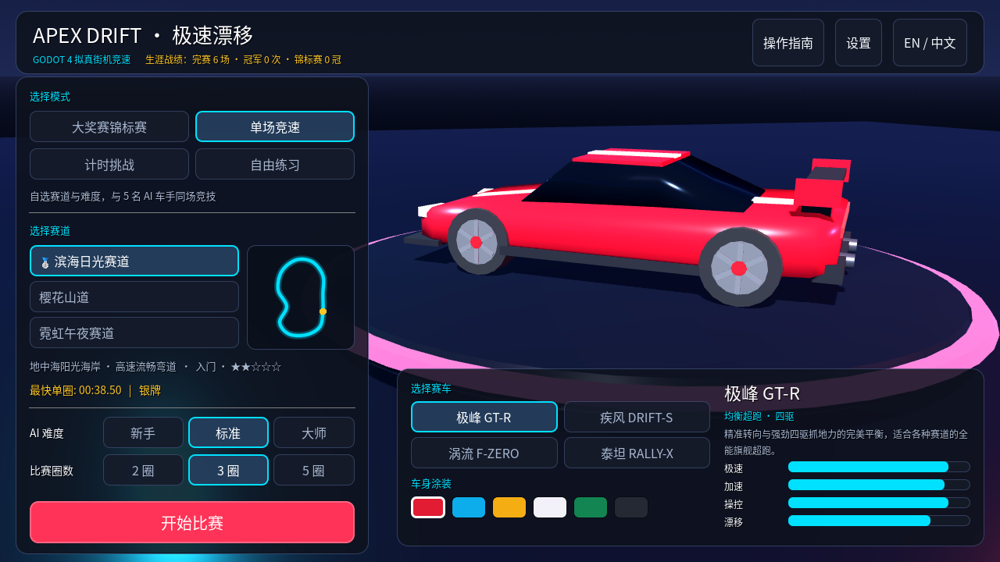
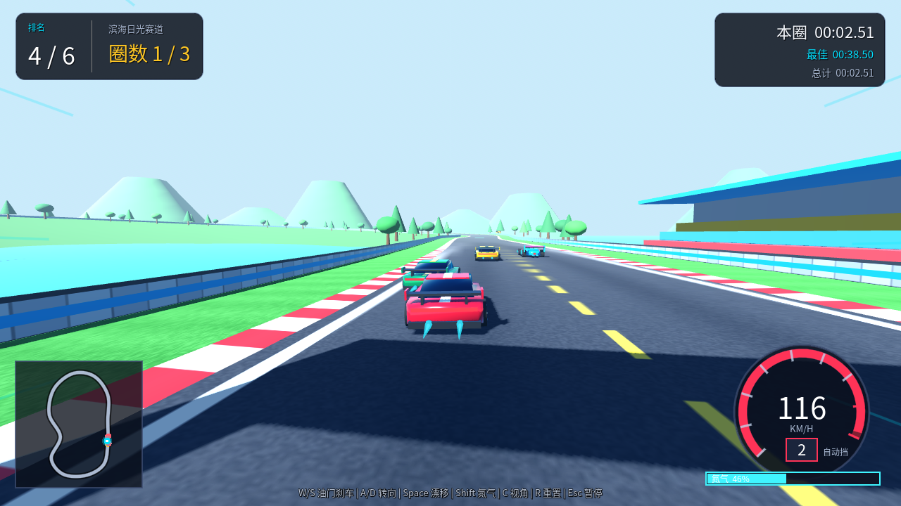
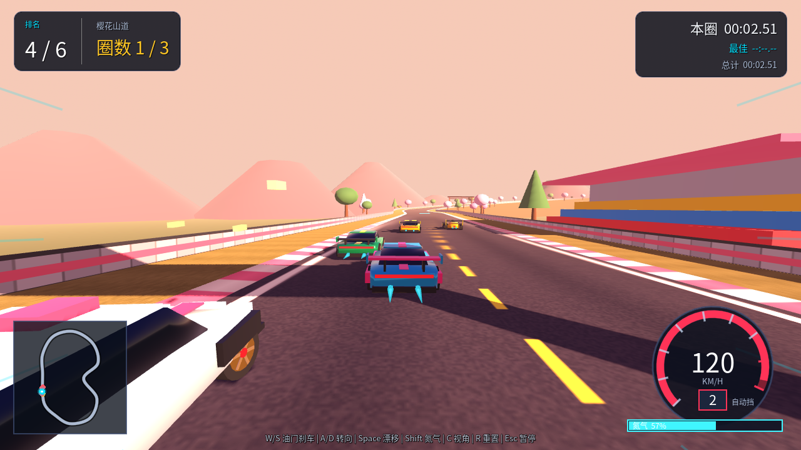
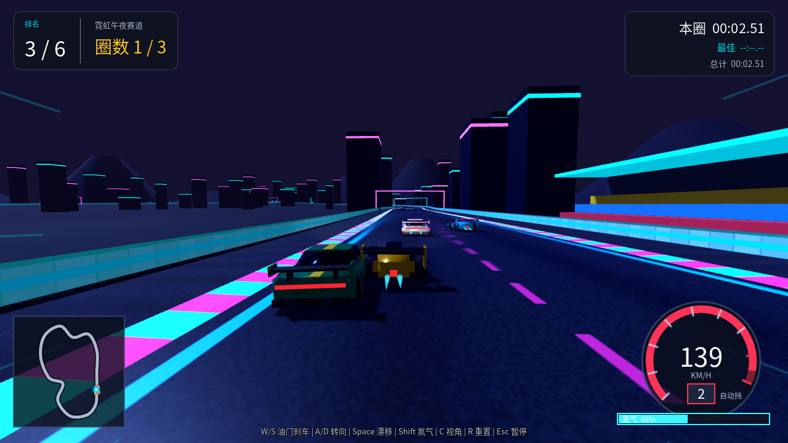

# Apex Drift · 极速漂移 (Godot 4)

A complete 3D arcade-simcade racing game built with **Godot 4.4+** (GL Compatibility — runs cleanly on Windows, macOS, Linux, and Web) powered by the MIT-licensed **[Godot Easy Vehicle Physics (GEVP)](https://github.com/DAShoe1/Godot-Easy-Vehicle-Physics)** 4-wheel raycast suspension & brush tire simulation.

一款基于 **Godot 4** 与 MIT 开源物理框架 **GEVP** 打造的完整体验 3D 竞速赛车游戏。内置完整赛事闭环、3 条风格迥异的 3D 赛道、4 辆差异化调校赛车、6 种涂装、5 名智能 AI 对手、计时赛幽灵车回放、漂移氮气系统与全程序化动态音效引擎。

---

## Screenshots / 游戏截图

| 主菜单 3D 旋转车库 · Main Menu Showroom | 滨海日光赛道 · Coastal Sunway |
|---|---|
|  |  |

| 樱花山道 · Sakura Mountain Pass | 霓虹午夜赛道 · Neon Midnight Circuit |
|---|---|
|  |  |

---

## Core Features / 核心特性

### 4 Complete Game Modes / 4 种完整游戏模式
- **大奖赛锦标赛 (Grand Prix)**: 连续征战全部 3 条赛道，按每站排名累计积分争夺总冠军。
- **单场竞速 (Quick Race)**: 自选赛道、圈数（2/3/5 圈）与 AI 难度（新手 / 标准 / 大师），与 5 名 AI 车手同场发车。
- **计时挑战 (Time Trial + Ghost Replay)**: 独自刷圈挑战金/银/铜牌目标时间，自动保存个人最快圈数据并生成**半透明全息幽灵车**同场竞逐。
- **自由练习 (Free Roam)**: 无圈数限制，自由磨练过弯走线与连续漂移连击。

### 3 Handcrafted 3D Circuits / 3 条特色 3D 赛道
1. **滨海日光赛道 (Coastal Sunway)** — 地中海日光海岸高速流畅赛道，带起伏坡度、海平面与环岛丘陵。
2. **樱花山道 (Sakura Mountain Pass)** — 暮色盘山公路，21m 海拔爬升、鸟居拱门、樱花林与连续漂移发卡弯。
3. **霓虹午夜赛道 (Neon Midnight Circuit)** — 赛博都市夜战赛道，霓虹光拱、反光沥青、发光路肩、城市摩天楼与车头远光灯。

### 4 Tuned Race Cars & 6 Liveries / 4 辆差异化赛车与 6 种涂装
- **极峰 GT-R (APEX GT-R)** — 均衡四驱超跑，精准好上手。
- **疾风 DRIFT-S (KAZE DRIFT-S)** — 宽体后驱漂移 coupe，横滑可控且漂移氮气充能 +40%。
- **涡流 F-ZERO (VORTEX F-ZERO)** — 轻量化高下压力方程式原型车，极速与高速弯之王。
- **泰坦 RALLY-X (TITAN RALLY-X)** — 全时四驱涡轮拉力钢炮，起步爆发强、路肩与非铺装抓地力拉满。

### Driving Mechanics & Motorsport Polish / 拟真街机手感与细节
- **GEVP 4 轮射线悬挂 + 轮胎滑移模型**：独立弹簧/阻尼/防倾杆、自动/手动 6 速变速箱、ABS/TCS/反打转向辅助与不同路面抓地力（柏油 / 路肩 / 草地 / 砂石）。
- **漂移充能 + 氮气加速 + 加速带**：侧滑起漂触发轮胎白烟、地面刹车痕与实时漂移得分并快速充能氮气；喷射氮气附带双焰尾喷、动态 FOV 拉伸与速度线特效。
- **完整 F1 发车与赛事系统**：5 盏 3D 龙门架发车红灯 + 弹射起步奖励、防作弊顺序检查点计圈、实时小地图、逆行警告、碰撞火花与镜头震动、多视角切换（近距 / 远距 / 车头 + 后视镜回看）。
- **内置中 / 英双语切换 + 本地存档**：一键切换简体中文 / English，自动保存最佳单圈、奖牌、幽灵车轨迹、生涯战绩与音量/辅助设置（`user://apex_drift_save.json`）。
- **全程序化动态音效**：实时随 RPM 变调的引擎声浪、随侧滑变化的胎噪、风噪、氮气喷射、换挡回火、碰撞闷响、发车提示音与可调背景合成波音乐。

---

## Controls / 操作按键

| Action / 操作 | Keyboard / 键盘 | Gamepad / 手柄 |
|---|---|---|
| Accelerate / 油门 | `W` / `↑` | `RT` |
| Brake & Reverse / 刹车与倒车 | `S` / `↓` | `LT` |
| Steer Left / Right / 左右转向 | `A` `D` / `←` `→` | Left Stick |
| Handbrake & Drift / 手刹起漂 | `Space` | `B` / Circle |
| Nitro Boost / 氮气加速 | `Shift` / `N` | `A` / Cross |
| Cycle Camera / 切换视角 | `C` | `X` / Square |
| Look Back / 后视回看 | `B` / `V` | — |
| Reset to Track / 赛道复位 | `R` | `Y` / Triangle |
| Auto / Manual Gearbox / 手自动切换 | `M` (`Q` 降挡 / `E` 升挡) | `LB` / `RB` |
| Pause / 暂停菜单 | `Esc` / `P` | `Start` |

---

## Quick Start / 快速运行

1. Install **Godot Engine 4.4+** ([godotengine.org](https://godotengine.org/download)).
2. Clone this repository:
   ```bash
   git clone https://github.com/zhouyuzhouyu/apex-drift-godot.git
   ```
3. Open Godot Engine → **Import** → select `apex-drift-godot/project.godot` → press **Play (`F5`)**.

### Run Automated Verification / 运行自动化验证

```bash
godot --headless --path . res://tests/verify_runner.tscn
```

---

## Project Architecture / 项目结构

```text
apex-drift-godot/
├── project.godot                   # Godot 4.4 config, InputMap, physics layers & autoloads
├── addons/gevp/                    # MIT-licensed Godot Easy Vehicle Physics core
├── scenes/
│   ├── main_menu.tscn              # Main Menu + 3D Rotating Showroom scene
│   ├── race_scene.tscn             # Playable Race scene
│   └── vehicle/race_car.tscn       # Reusable GEVP RaceCar prefab
├── scripts/
│   ├── autoload/
│   │   ├── game_state.gd           # Modes, Grand Prix standings, save/load, ghost & i18n
│   │   └── audio_manager.gd        # Procedural WAV synthesizer & dynamic driving audio
│   ├── data/
│   │   ├── car_catalog.gd          # 4 tuned race cars, 6 liveries, 5 AI rivals
│   │   └── track_catalog.gd        # 3 handcrafted circuits & environmental themes
│   ├── track/
│   │   ├── track_spline.gd         # Closed Catmull-Rom spline, banking, curvature, minimap
│   │   ├── track_builder.gd        # Procedural 3D track, colliders, gantry, boost pads & props
│   │   ├── texture_factory.gd      # Procedural asphalt, kerbs, barriers, chevrons & boost pads
│   │   └── race_manager.gd         # Race director, F1 lights, laps, rankings, ghost & results
│   ├── vehicle/
│   │   ├── car_mesh_builder.gd     # Sculpted multi-part 3D car & alloy wheel generator
│   │   ├── race_car.gd             # GEVP Vehicle subclass with nitro, drift, smoke & skidmarks
│   │   ├── player_controller.gd    # Keyboard/gamepad input + reverse & audio bridge
│   │   ├── ai_driver.gd            # Pure-pursuit spline AI with overtaking & curvature braking
│   │   ├── chase_camera.gd         # 3 camera modes, rear-view, dynamic FOV & finish orbit
│   │   └── ghost_car.gd            # Holographic Time Trial best-lap ghost car
│   └── ui/
│       ├── ui_theme.gd             # CJK-ready motorsport dark-glass UI theme
│       ├── main_menu.gd            # Showroom UI, garage, track preview, settings & controls
│       ├── race_hud.gd             # Custom vector tachometer/speedometer, minimap & HUD
│       ├── pause_menu.gd           # In-race pause overlay
│       └── results_screen.gd       # Post-race classification, medals & Grand Prix podium
└── tests/
    ├── verify_game.gd              # Automated track, GEVP physics, AI & ghost test suite
    └── verify_runner.tscn
```

---

## Credits & License / 致谢与许可

- Licensed under the **MIT License** (see [LICENSE](LICENSE)).
- Vehicle physics foundation adapted from **[Godot Easy Vehicle Physics (GEVP)](https://github.com/DAShoe1/Godot-Easy-Vehicle-Physics)** (MIT License, Copyright © David Shoemaker, Dechode, Baron Wittman).
